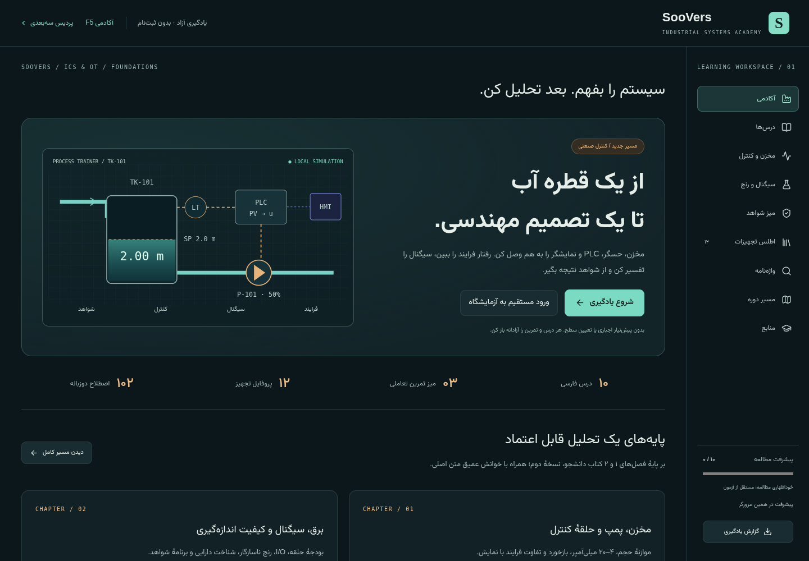

# SooVers Academy

A self-hosted, Persian-first academy for **industrial control systems (ICS/OT)** and F5 BIG-IP. The industrial academy combines ten Persian lessons, the uploaded student book’s original reading, twelve equipment profiles, a 102-term glossary and three interactive workbenches. Learners can study every available lesson without placement or mandatory assessment. Account progress persists across browsers and server restarts.

The editable source is now in this repository. `SooVers_Demo_0.5.0 (1).zip` remains the original, untouched demo baseline.

## Run locally

Requires Node.js **24+** and pnpm **11.25.0**.

```sh
npm install --global pnpm@11.25.0
pnpm install --frozen-lockfile
pnpm build
pnpm start
```

Open the server on `127.0.0.1:8080` from the machine running it. SQLite is created and migrated automatically at `data/soovers.sqlite`. No external service or secret is needed for local evaluation. Use the UI to create your own account; no default account/password is shipped.

For frontend development, run these in two terminals after the first build:

```sh
PORT=8081 APP_ORIGIN=http://127.0.0.1:8080 pnpm start
pnpm dev
```

Vite proxies `/api` to the application server. Restart the API process after server changes. Use the exact origin configured in `APP_ORIGIN`.

## Interactive demo

- [Open the hosted interactive demo](https://soovers-academy-demo.nutmegtern65.chatgpt.site) — private preview for the owning ChatGPT account; Sites may ask you to sign in. No academy account is needed.
- [Download the earlier F5 portable demo (v1.0.0)](https://github.com/S00rin/Soovers/releases/tag/v1.0.0) — extract and run `node run.mjs` with Node 24+, or use `START_WINDOWS.bat`. No dependency installation is needed to run the built preview.

`pnpm build:demo` creates a static, account-free preview in `demo-dist/`. The optional GitHub Pages workflow can publish that preview after Pages is enabled in the repository settings. A separately published `demo` branch contains the ready-to-serve static build. The full application and its account API remain in the Docker deployment.

Placement and assessments are optional. Learners can enter the classroom, laboratory and every lesson without taking a placement test. Skipping does not create an assessment result; the test remains available for personalized suggestions.

## Industrial academy



- Default static demo: ICS/OT academy. `#demo` retains the F5 preview; `#tower` opens the campus.
- Authenticated application: choose **شروع آکادمی صنعتی**. No F5 enrollment is required. Study progress, evidence notes and optional quiz results belong to the signed-in account.
- Delivered content: Chapters 1–2, the initial equipment atlas and glossary. The 34-chapter / 816-hour curriculum is a **development roadmap**, not a claim that all chapters are available.
- [Content provenance and scope](docs/ICS_CONTENT.md) records the supplied DOCX, source section mapping, simulation assumptions and what has not been imported.
- The downloadable **v1.0.0** release above is the earlier F5 release; use the current source or hosted demo for the new industrial content.

## Docker handoff

See [the infrastructure runbook](docs/OPERATIONS.md) for HTTPS setup, configuration, backups, recovery, updates, and rollback.

```sh
export APP_ORIGIN=https://academy.your-company.example
# Change the example above to the real HTTPS origin served by your reverse proxy.
docker compose up -d --build
```

Compose publishes only to the host's loopback interface. Put your HTTPS reverse proxy in front of port 8080. Its named volume preserves the database. Production rejects missing/insecure public-origin configuration. Runtime uses Node's built-in HTTP, crypto, and SQLite libraries; it has no npm runtime dependencies.

## Verify

```sh
pnpm check
pnpm test
pnpm test:api
pnpm build
pnpm build:demo
pnpm test:server
pnpm exec playwright install chromium
pnpm test:ics:browser
pnpm test:product
pnpm test:f5:browser
pnpm test:browser
```

Set `CHROMIUM_PATH` if Chromium is already installed. `TEST_LOW_QUALITY=1` reduces rendering cost for the legacy campus tests. The browser suites should run sequentially. Container validation after building `soovers-academy:1.0.0`:

```sh
node scripts/test-container.mjs
```

To generate the source/deployment ZIP (including the built site and file checksums):

```sh
python3 scripts/package-release.py
```

The archive excludes dependencies, databases, local environment files, and the original demo ZIP.

## Product boundaries

- **Operational:** registration/login/logout, password changes, enrollment, account-specific durable progress, server-graded lab submissions and formative assessments, attempt history, server-generated JSON reports, operator account recovery, database migrations and backups.
- **Educational simulation:** device geometry, traffic, logs and all lab commands. Nothing connects to or changes a real F5 device or industrial controller. Reports are learning records, not F5 certification. Answers are available in the educational client bundle; this is not a proctored or tamper-resistant credentialing system.
- **Preview:** the broader 3D cybersecurity campus and its role selector retain local demo behavior. They cannot grant account privileges and do not write academy records. `#demo` explicitly opens the original local course preview.
- **Not included:** email verification or email-based recovery, enterprise SSO/MFA, instructor/cohort management, billing, live classes, real-device labs, SIEM integrations, multi-server database replication, or verified headset support.

The deployment target is one server with durable local storage, for a controlled academy rollout. Production infrastructure still needs a real domain, TLS, an operator contact, backup scheduling, and restore verification on the team's infrastructure. Capacity testing and independent security review remain release work before a large public launch.

See [product design and acceptance criteria](docs/PRODUCT.md) and [validation results](docs/VALIDATION_1.0.md). Older demo documents remain historical references.
